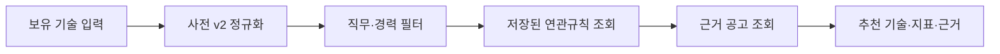
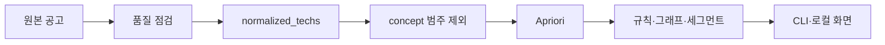
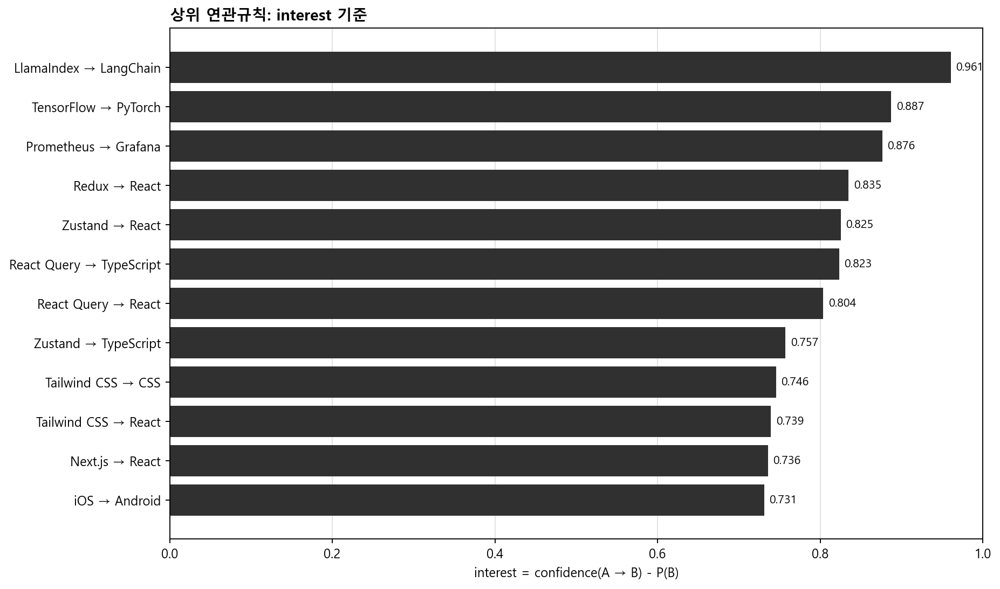
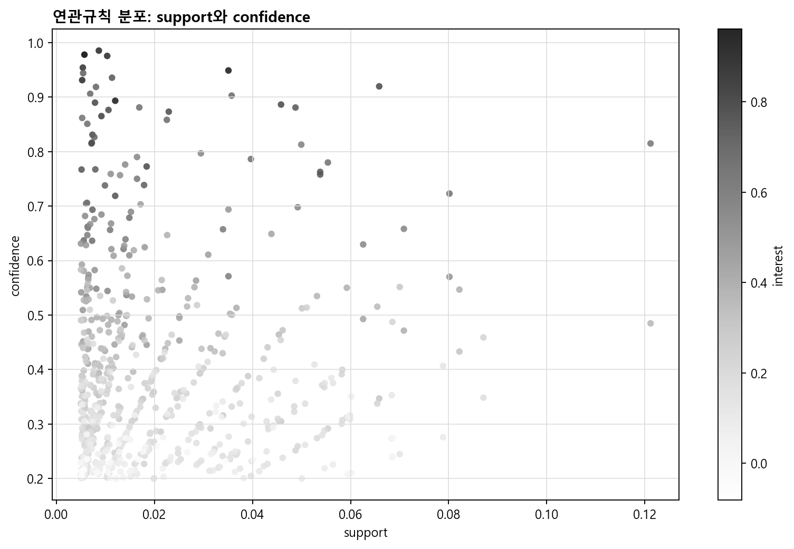
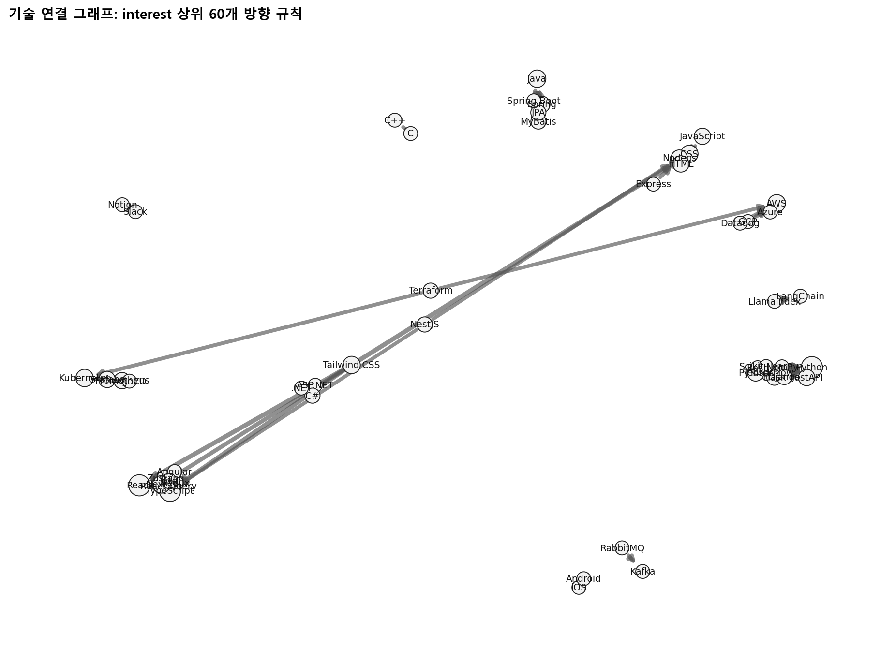

# JobGuts

> 국내 IT 채용공고의 기술 조합에서, 다음에 검토할 기술과 그 근거 공고를 함께 찾습니다.

   

**바로가기** · [요약](#한눈에-보기) · [분석 흐름](#분석-흐름) · [실행 결과](#실행-결과) · [재현](#재현-방법) · [주차별 보고서](#주차별-보고서) · [한계](#한계와-다음-작업)

## 한눈에 보기

| 항목 | 현재 재현 결과 |
| --- | ---: |
| 원본 공고 | 40,348건 |
| Apriori 분석 트랜잭션 | 15,296건 |
| 저장 연관규칙 | 670개 |
| 추천 가능한 선행 기술 | 88종 |
| 사전 v2 | 표준 이름 130개 · 표기 314개 |
| 전체 검증 | 148개 통과 |

JobGuts는 공고 하나를 기술 집합으로 보고 Apriori 연관규칙을 계산한다. 사용자가 기술을 입력하면 표기를 정리한 뒤, 저장된 규칙과 실제 공고 근거를 함께 반환한다. `support`는 동시 출현 비율, `confidence`는 선행 기술이 있을 때 결과 기술이 나타난 비율, `interest`는 `confidence(A → B) - P(B)`이다.



## 분석 흐름



- 원본 출발 필드는 `final_techs`이며 `hard_skills`는 대조용으로 보존한다.
- `source + job_id` 중복 777건과 동일 본문 중복 933건을 제외한다.
- `concept` 범주 14개는 기술 조합이 아니므로 Apriori 항목에서 제외한다. 이 조건에서 11,775개 항목이 제외됐고, 빈 기술 집합이 된 공고는 분석에 포함하지 않는다.
- 직무·경력 필터는 근거 공고를 좁히는 용도이며, 저장된 규칙의 지표를 다시 계산하지 않는다.

## 실행 결과



*그림 1. `artifacts/week12_all_rules.json`의 정규화 규칙 670개 중 interest 상위 12개. 생성 조건: 최소 support 0.005, confidence 0.2, concept 범주 제외.*



*그림 2. 같은 규칙의 support·confidence 분포. 색상은 interest를 나타낸다.*



*그림 3. `artifacts/week14_skill_graph.json`에서 interest 상위 60개 방향 규칙을 그린 그래프. 노드는 기술명, 화살표는 추천 방향, 선 굵기는 interest를 뜻한다.*

<details>
<summary>현재 산출물과 조건</summary>

| 파일 | 내용 |
| --- | --- |
| `artifacts/week10_data_quality_summary.json` | 입력 범위·결측·중복 품질 요약 |
| `artifacts/week11_normalization_summary.json` | 사전 v2·정규화·메타데이터 요약 |
| `artifacts/week12_rule_comparison.json` | raw/normalized 비교와 제외 조건 |
| `artifacts/week12_all_rules.json` | 조건을 통과한 전체 규칙 670개 |
| `artifacts/week13_service_scenarios.json` | 정상·규칙 없음·필터 등 조회 시나리오 |
| `artifacts/week14_segment_comparison.json` | 세그먼트·상위 3개 기술 조합 |
| `artifacts/week14_skill_graph.json` | 88 노드·670 방향 엣지 |

</details>

## 재현 방법

Python 3.10 이상이 필요하다. 원본 데이터와 비밀값은 저장소에 넣지 않는다.

```powershell
git clone https://github.com/k0ng-min/2026_bigdata_JobGuts.git
cd 2026_bigdata_JobGuts
git switch gyeongseon
python -m venv .venv
.\.venv\Scripts\python -m pip install -r requirements.txt
Invoke-WebRequest -Uri "https://huggingface.co/datasets/young-cc/korean-it-recruit-dataset/resolve/main/master_merged_v5.json?download=true" -OutFile data/raw/korean_it_recruit_postings.json
.\scripts\run_pipeline.ps1
```

개별 실행은 `src.ingestion.run_week10` → `src.normalization.run_week11` → `src.analysis.run_week12` → `src.service.run_week13` → `src.analysis.run_week14` 순서다. 시각화는 다음 명령으로 다시 만든다.

```powershell
.\.venv\Scripts\python scripts\build_visualizations.py
.\.venv\Scripts\python -m unittest discover -s tests -q
```

추천 결과는 CLI 또는 로컬 화면에서 확인한다.

```powershell
.\.venv\Scripts\python -m src.service.app --skills "파이썬"
.\.venv\Scripts\python -m src.service.web_server
```

## 저장소 지도

| 경로 | 역할 |
| --- | --- |
| `data/` | 원본·처리 데이터 경로(원본은 Git 제외) |
| `configs/` | 사전 v2, 분류, 분석 파라미터 |
| `src/ingestion/` | 로딩·품질 점검 |
| `src/normalization/` | 표기 정리·직무/경력 메타데이터 |
| `src/analysis/` | Apriori·규칙·그래프·세그먼트 |
| `src/retrieval/`, `src/service/` | 규칙·근거 공고 조회, CLI·로컬 화면 |
| `artifacts/` | 추적 가능한 분석 결과 |
| `docs/`, `reports/` | 설계 근거·주차별 보고서 |
| `tests/` | 재현·회귀 검증 |

## 주차별 보고서

| 주차 | 핵심 산출물 | 다운로드 |
| --- | --- | --- |
| 10주차 | 데이터 범위·품질 점검 | [DOCX](reports/weekly/week10_project_progress_report.docx) |
| 11주차 | 기술 사전·정규화·메타데이터 | [DOCX](reports/weekly/week11_project_progress_report.docx) |
| 12주차 | Apriori·연관규칙·지표 | [DOCX](reports/weekly/week12_project_progress_report.docx) |
| 13주차 | 규칙·근거 공고 조회 | [DOCX](reports/weekly/week13_project_progress_report.docx) |
| 14주차 | 세그먼트·연결 그래프·통합 검증 | [DOCX](reports/weekly/week14_project_progress_report.docx) |

## 한계와 다음 작업

- 실제 GLM 연결은 이번 범위에서 제외했다. 현재는 인터페이스와 mock 경로만 있다.
- 직무는 공식 레이블이 아니라 제목 신호 기반 메타데이터이므로, 세그먼트 결과를 시장 전체 결과로 일반화할 수 없다.
- 사전에 없는 표기는 원문을 유지한다. 사람 검수와 사전 확장은 별도 검증이 필요하다.
- 추천 결과는 채용·학습·커리어 성공을 보장하지 않는다.

원본 데이터는 [young-cc/korean-it-recruit-dataset](https://huggingface.co/datasets/young-cc/korean-it-recruit-dataset)의 CC BY 4.0 조건을 따른다. 코드 라이선스는 [MIT](LICENSE)이다.
