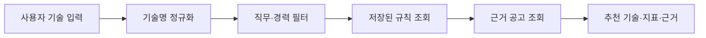
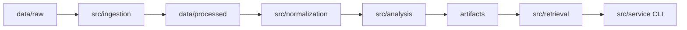

# JobGuts

> 국내 IT 채용공고의 기술 조합을 분석해, 보유 기술 다음에 함께 검토할 기술과 실제 근거 공고를 제시합니다.

   

`Apriori` · `Association Rules` · `Evidence-based Recommendation` · `Reproducible Pipeline`

**JobGuts**는 채용공고 하나를 기술 트랜잭션으로 보고 빈발 기술 조합을 분석합니다. 사용자는 보유 기술을 입력하고, 규칙의 support·confidence·interest와 함께 실제 공고 근거를 확인할 수 있습니다.

**바로가기:** [요약](#요약) · [기능](#기능과-사용자-흐름) · [결과](#실행-결과) · [재현](#재현-방법) · [저장소-지도](#저장소-지도) · [주차별-기록](#주차별-기록) · [한계와-향후-작업](#한계와-향후-작업)

---

## 요약

| 항목 | 실제 실행 결과 |
| --- | --- |
| 입력 데이터 | `young-cc/korean-it-recruit-dataset`의 `master_merged_v5.json` |
| 입력 행 | 40,348 |
| 분석 트랜잭션 | 17,796 |
| 중복 제외 | `source + job_id` 777행, 동일 본문 933행 |
| 정규화 사전 | `tech-dictionary.v1`, 별칭 변환 127건 |
| 연관규칙 | 최소 support 0.005, confidence 0.2에서 694개 (선행 기술 94종) |
| 테스트 | `unittest` 20개 통과 |

**핵심 발견 예시:** `TensorFlow → PyTorch` 규칙은 support **0.0302**, confidence **0.9488**, interest **0.8959**로 계산되었습니다. 이 수치는 17,796개 분석 트랜잭션과 현재 사전·필터 조건에만 적용됩니다.



## 기능과 사용자 흐름

- **기술명 정규화**: 원본 `final_techs`를 보존하고 `normalized_techs`를 추가합니다.
- **연관규칙 분석**: 공고별 중복 없는 기술 집합에서 Apriori 방식의 2개 기술 규칙을 계산합니다.
- **지표**: support는 조합의 비율, confidence는 선행 기술 보유 시 결과 기술의 조건부 비율입니다. `interest = confidence(A → B) - P(B)`이며 동일 분석 세그먼트에서 계산합니다.
- **근거 제시**: 추천 결과에는 `source`, `job_id`, `title`의 실제 공고 근거를 최대 3건 제공합니다.
- **CLI 서비스**: 규칙 없음은 `no_rules`, 근거가 필터를 만족하지 않으면 `insufficient_sample` 상태로 반환합니다.
- **필터**: 직무(`--role`), 경력 라벨(`--experience`), 신입 지원 가능 여부(`--entry-eligible`)로 근거 공고를 좁힙니다. 경력 라벨은 원본 표기를 그대로 유지하며 `경력무관`을 `신입`으로 바꾸지 않습니다.
- **GLM 상태**: 제공자 독립 인터페이스와 fake provider만 구현되어 있습니다. 실제 GLM API·키·SDK·HTTP 호출은 **미구현**입니다.

```powershell
python -m src.service.app --skills TensorFlow
python -m src.service.app --skills NotARealSkill
python -m src.service.app --skills TensorFlow --role frontend
python -m src.service.app --skills TensorFlow --entry-eligible
```

## 실행 결과

### 기술 조합과 세그먼트

`artifacts/week14_segment_comparison.json`에는 실제 상위 3개 기술 조합과 제목·경력 라벨 기반 세그먼트 표본이 있습니다. 12주차와 동일한 적격 공고 **17,796**건에서 `AWS + Java + Spring` 조합은 **724**회, `Java + JavaScript + Spring` 조합은 **710**회, `CSS + HTML + JavaScript` 조합은 **647**회 관측되었습니다.

기술 연결 그래프 데이터는 [week14_skill_graph.json](artifacts/week14_skill_graph.json)에 저장됩니다. 노드 94개, 엣지 694개로 전체 규칙을 보존하며, 각 엣지의 `support`, `confidence`, `interest`는 해당 규칙 테이블 값입니다.

<details>
<summary>분석 조건과 세부 지표 보기</summary>

| 설정 | 값 |
| --- | --- |
| 원본 기술 필드 | `final_techs` |
| 비교 기술 필드 | `normalized_techs` |
| 최소 support | 0.005 |
| 최소 confidence | 0.2 |
| 최대 itemset 크기 | 2 (규칙 분석) |
| 3개 기술 조합 | 별도 빈도 요약 산출물 |
| 사전 버전 | `tech-dictionary.v1` |

</details>

## 분석 신뢰성 및 한계

- 데이터 출처는 [young-cc/korean-it-recruit-dataset](https://huggingface.co/datasets/young-cc/korean-it-recruit-dataset)이며 라이선스는 CC BY 4.0입니다.
- 원본·중간·처리 데이터는 Git에서 제외합니다. 입력 파일 SHA-256과 품질 요약은 [week10_data_quality_summary.json](artifacts/week10_data_quality_summary.json)에 남깁니다.
- `final_techs`를 분석 출발점으로 사용하고 `hard_skills`는 대조용으로 보존합니다.
- 원본에 공식 직무 분류 열이 없어 직무 메타데이터는 제목의 명시적 신호를 기반으로 합니다. 세그먼트 결과는 이 제약을 전제로 해석해야 합니다.
- 공고 최신성, 표본 부족, 기술 라벨 오류는 결과에 영향을 줄 수 있습니다. 추천은 채용·학습·커리어 성공을 보장하지 않습니다.

## 재현 방법

### 준비

Python 3.10 이상과 공개 원본 파일이 필요합니다. 원본은 Git에 커밋하지 않습니다.

```powershell
Invoke-WebRequest -Uri "https://huggingface.co/datasets/young-cc/korean-it-recruit-dataset/resolve/main/master_merged_v5.json?download=true" -OutFile data/raw/korean_it_recruit_postings.json
./scripts/run_pipeline.ps1
```

실행 순서: 원본 품질 점검 → 정규화 → 규칙 분석 → 서비스 시나리오 → 세그먼트·그래프 → 테스트 → CLI 추천 예시입니다. 생성되는 주요 결과는 `artifacts/week10_data_quality_summary.json`, `artifacts/week11_normalization_summary.json`, `artifacts/week12_rule_comparison.json`, `artifacts/week12_all_rules.json`(전체 694개 규칙), `artifacts/week12_top_rules.json`(보고용 상위 N개), `artifacts/week13_service_scenarios.json`, `artifacts/week14_segment_comparison.json`, `artifacts/week14_skill_graph.json`입니다.

WSL이나 macOS에서는 `Invoke-WebRequest`를 `curl -fL -o <경로> "<주소>"`로, `./scripts/run_pipeline.ps1`을 같은 순서의 `python -m ...` 명령으로 바꿔 실행합니다. 전체 명령은 [01_baseline_check.md](docs/gyeongseon/01_baseline_check.md)의 마지막 절에 있습니다.

비밀값은 저장소에 넣지 않습니다. 향후 GLM을 연결할 경우에도 `.env`에서만 관리해야 하며, 현재는 필요한 환경변수가 확정되지 않았습니다.

## 저장소 지도



| 경로 | 역할 |
| --- | --- |
| `data/` | 원본·중간·처리 데이터 경로. 대용량 데이터는 Git 제외 |
| `src/ingestion/` | 로더, 스키마·결측·중복 품질 점검 |
| `src/normalization/` | 기술 사전, 정규화, 직무·경력 메타데이터 |
| `src/analysis/` | 규칙, interest, 세그먼트 요약, 그래프 데이터 |
| `src/retrieval/` | 저장된 규칙과 근거 공고 조회 |
| `src/service/` | CLI 추천 흐름 |
| `configs/` | 데이터 범위·기술 사전·실험 파라미터 |
| `artifacts/` | 검증 가능한 요약·규칙·그래프 산출물 |
| `docs/` | 데이터 출처, 주차별 실제 결과, 최종 보고서 |
| `tests/` | 단위·통합 테스트 |
| `scripts/` | 전체 재현 실행 스크립트 |

## 주차별 기록

| 주차 | 실제 산출물 | 검증·이슈 |
| --- | --- | --- |
| 10주차 | 로더·품질 보고서·중복 기준 | 40,348행 입력과 결측·중복 집계 |
| 11주차 | 기술 사전·정규화·LLM mock 계약 | 별칭 변환 127건, 실제 GLM 미연결 |
| 12주차 | 규칙·interest·전후 비교 | 17,796 트랜잭션, 694 규칙 |
| 13주차 | 규칙 조회·근거 공고·CLI | 정상·규칙 없음 경로 검증 |
| 14주차 | 세그먼트 요약·그래프·통합 검증 | CLI 시나리오와 20개 테스트 통과 |

자세한 실제 기록: [10주차](docs/weeks/week10_actual_results.md) · [11주차](docs/weeks/week11_actual_results.md) · [12주차](docs/weeks/week12_actual_results.md) · [13주차](docs/weeks/week13_actual_results.md) · [14주차](docs/weeks/week14_actual_results.md)

## 역할

| 영역 | 책임 |
| --- | --- |
| 데이터 확보·전처리 | 데이터 선택, 로딩, 결측·중복·범위 관리 |
| 기술명 정규화·검증 | 사전, 별칭, 원본·정규화 배열 보존 |
| Apriori·연관규칙 | 트랜잭션, 규칙, 지표, 그래프 산출물 |
| 서비스·GLM 준비 | 규칙 조회, 근거 제시, CLI 흐름, LLM 경계 |

## 한계와 향후 작업

- **GLM 최종 연결**: 현재 미구현. provider interface와 fake provider만 있습니다.
- **데이터 최신화**: 새 export를 받아 동일 재현 파이프라인을 다시 실행해야 합니다.
- **추천 품질 평가**: 사용자 피드백이나 별도 평가셋을 이용한 품질 측정은 미구현입니다.
- **기술명 사전**: `tech-dictionary.v1`의 별칭 변환 127건은 전부 `Ajax` → `AJAX` 한 종류이며, 원본 어휘 156개 중 14개만 등재되어 있습니다. 사전 확장은 향후 작업입니다.
- **UI·배포·모니터링**: 기준 인터페이스는 CLI이며, `src/service/web_server.py`에 로컬 확인용 웹 화면이 있습니다. 외부 공개 배포와 모니터링은 향후 작업입니다.

---

팀: JOBGUTS · 서동균, 김경선, 정비호, 설경민
