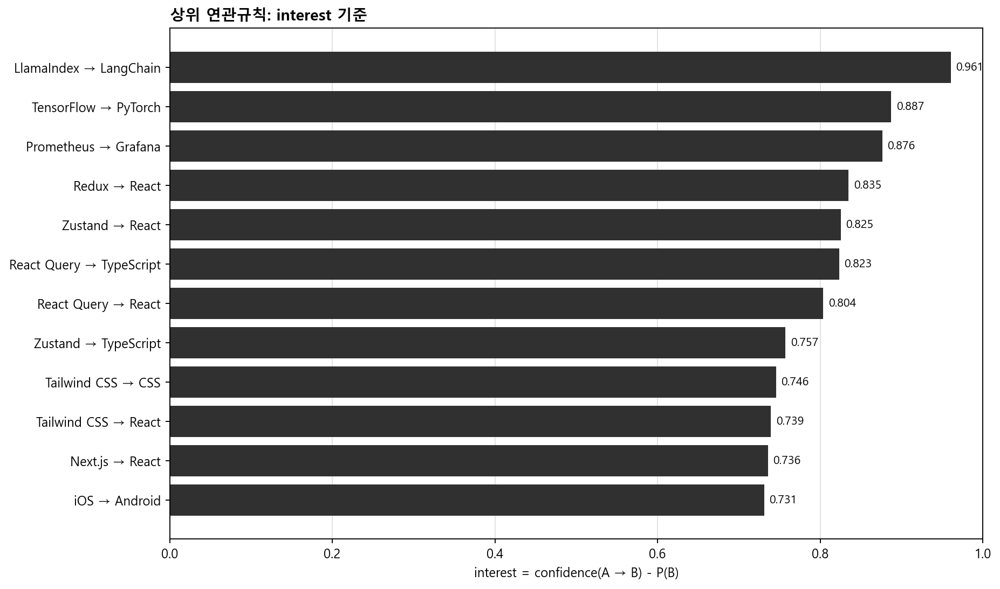
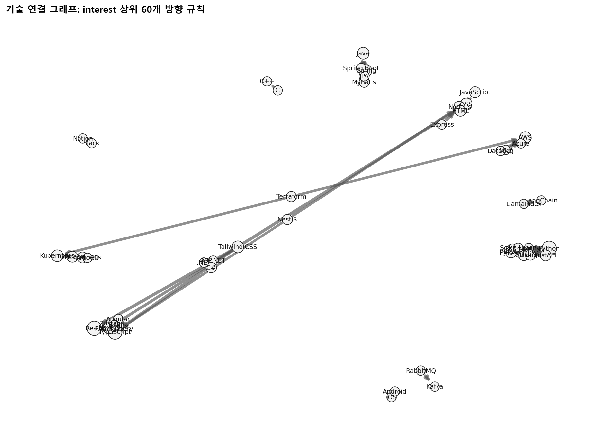

# JobGuts 최종 구현 보고

## 1. 프로젝트 목적

JobGuts는 국내 IT 채용공고의 기술 조합을 Apriori 연관규칙으로 분석하고, 사용자가 보유한 기술 다음에 함께 검토할 기술과 실제 근거 공고를 제시한다. 추천은 단순 기술 목록이 아니라 support, confidence, interest와 공고 식별자를 함께 반환하는 근거 중심 조회로 설계했다.

## 2. 데이터와 분석 기준

| 항목 | 실제 결과 |
| --- | ---: |
| 입력 공고 | 40,348건 |
| 정확한 ID 중복 제외 | 777건 |
| 동일 본문 중복 제외 | 933건 |
| concept 항목 제외 | 11,775개 |
| 최종 분석 트랜잭션 | 15,296건 |
| 최소 support / confidence | 0.005 / 0.2 |
| 저장 규칙 | 670개 |

원본 기술 필드는 final_techs이고, 정규화 결과는 원본을 바꾸지 않고 normalized_techs에 저장한다. 같은 본문을 가진 서로 다른 ID는 과대 집계를 줄이기 위해 분석에서 제외한다. AI, DevOps처럼 기술 조합보다 개념에 가까운 concept 범주는 Apriori 항목에서 제외했다.

## 3. 기술명 사전과 정규화

사전 v2는 표준 이름 130개와 표기 314개를 포함한다. 한글 표기, 대소문자, 구두점 표기, 검토된 별칭을 같은 표준 이름으로 연결한다. 사전 밖 표기는 임의로 고치지 않고 원문을 보존한다.

사전 형식은 기존 v1과 v2를 모두 읽도록 호환 처리했다. 따라서 기존 산출물을 다시 확인할 수 있으면서, 실제 분석·CLI·로컬 화면의 기본 사전은 v2가 된다.

## 4. 연관규칙과 시각화

interest = confidence(A → B) - P(B)로 계산한다. 결과 기술이 원래 자주 등장하는 경우를 보정해, 단순 출현 빈도와 다른 연결을 확인할 수 있게 했다.

*그림 1. 최소 support 0.005, confidence 0.2, concept 제외 조건으로 계산한 interest 상위 규칙.*

*그림 2. 전체 규칙 그래프에서 interest 상위 60개 방향 연결. 노드는 기술, 선은 추천 방향이다.*

## 5. 서비스 조회와 검증

조회 계층은 저장된 규칙을 다시 학습하지 않고 읽는다. 입력 기술을 사전 v2로 정리한 뒤 규칙을 찾고, 직무·경력·신입 가능 조건으로 근거 공고를 좁힌다. 정상 추천, 규칙 없음, 직무 필터, 신입 가능, 표본 부족 경로를 시나리오로 확인했다.

테스트는 총 148개가 통과했다. v2 사전 표기 로딩, concept 제외, 중복 정책, 메타데이터, 규칙·근거 공고 조회, 에이전트 보조 모듈을 포함한다.

## 6. 재현 방법

~~~powershell
python -m venv .venv
.\\.venv\\Scripts\\python -m pip install -r requirements.txt
.\\scripts\\run_pipeline.ps1
.\\.venv\\Scripts\\python scripts\\build_visualizations.py
.\\.venv\\Scripts\\python -m unittest discover -s tests -q
~~~

원본 데이터는 data/raw/korean_it_recruit_postings.json에 별도로 받아야 하며 저장소에 포함하지 않는다. 입력 파일 경로와 SHA-256은 docs/gyeongseon/00_summary.md에 기록한다.

## 7. 한계와 이후 작업

- 실제 GLM 연결은 수행하지 않았다. 현재는 인터페이스와 mock 경로만 준비된 상태다.
- 직무 분류는 공식 열이 아닌 제목 신호 기반 보조 메타데이터다.
- 사람 검수 시트는 독립된 검수자의 실제 판정이 필요한 단계다. 작성자가 대신 채우지 않는다.
- 표준 어휘 밖 표기는 출현 빈도와 문맥을 검토한 뒤 별도 사전 변경과 전후 비교를 거쳐야 한다.
