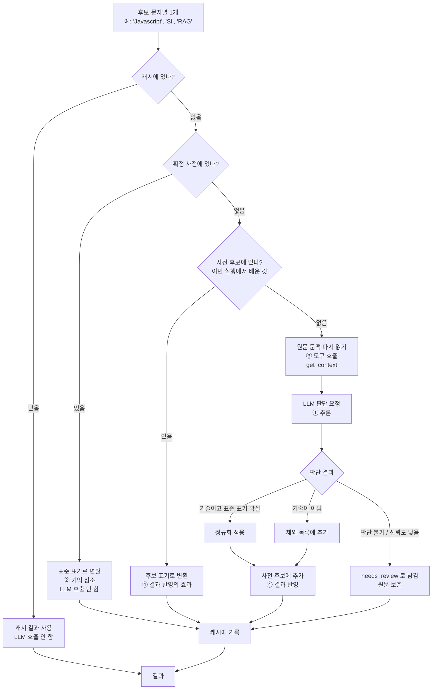
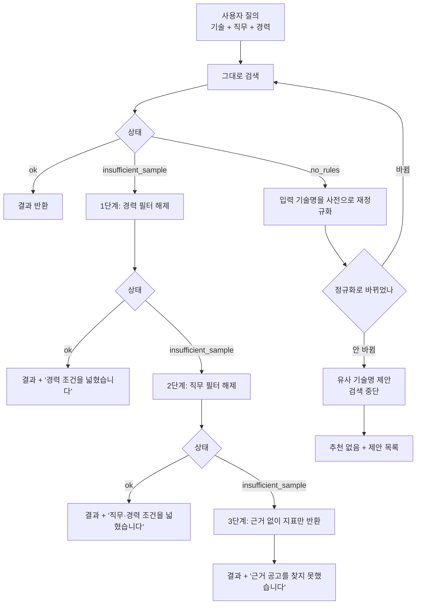

# 03. LLM 에이전트 설계 (gyeongseon)

- 작성 일자: 2026-11-18
- 작성 브랜치: `gyeongseon`
- 선행 문서: [01_baseline_check.md](01_baseline_check.md), [02_foundation_fixes.md](02_foundation_fixes.md)
- **이 문서는 설계만 담습니다. 코드는 아직 작성하지 않았습니다.**
- 실제 GLM은 연결 전이며, 기존 `src/llm`의 `LLMProvider` 인터페이스와 `FakeLLMProvider`로 흐름부터 만듭니다.

## 왜 이 설계가 필요한가

[01_baseline_check.md](01_baseline_check.md) 2-3절에서 확인한 사실입니다.

- 원본의 `final_techs`는 **이미 정리된 156개 닫힌 어휘**입니다.
- 그래서 사전 별칭 변환 127건이 전부 `Ajax` → `AJAX` 하나였고, 사전 14개 항목 중 13개는 작동하지 않았습니다.
- 결과적으로 "정규화 전 694개 / 정규화 후 694개 / 공통 694개"가 되어 **비교 자체가 무의미**했습니다.

정리할 게 없는 데이터를 정리해도 아무 일도 일어나지 않습니다.
그래서 **"정리 전" 기준을 `raw_text`에서 새로 만들고**, 에이전트가 그것을 정리하는 구조로 바꿉니다.

이 문서를 쓰면서 실제로 측정해 본 결과, 새 기준은 비교가 성립합니다.

| 같은 공고 17,796건 기준 | 항목 수 | 규칙 수 | 선행 기술 |
| --- | ---: | ---: | ---: |
| 기존 "정리 전"(`final_techs`) | 156 | 694 | 94종 |
| 기존 "정리 후"(`normalized_techs`) | 156 | **694 (동일)** | 94종 |
| **새 "정리 전"(`raw_text` 추출)** | **51,444** | **1,873** | **318종** |

새 기준과 현재 정리 결과는 공통 규칙이 412개뿐입니다(정리 전에만 1,461개, 정리 후에만 282개).
즉 **정리 작업이 결과를 실제로 바꿉니다.** 이제 "정리가 분석에 기여했는가"를 물을 수 있습니다.

---

# 1. 정리 전 목록 만들기

## 1-1. 실제 공고 20건을 읽고 확인한 것

`random.seed(31415)`로 20건을 뽑아 `raw_text`를 직접 읽었습니다. 공고는 크게 두 종류였습니다.

### 종류 1 — 기술 목록이 한 줄로 정리되어 있는 공고

`jobkorea/49323876` (샘플 7):

```
스킬 Ajax, Android, Flutter, iOS, JAVA, Javascript, Oracle, Spring Boot, SQL, Unix
```

`final_techs`는 `['Flutter','Ajax','Spring','Android','SQL','iOS','Java','Oracle','JavaScript']`입니다.
원문의 `JAVA` → `Java`, `Javascript` → `JavaScript`, `Spring Boot` → `Spring`으로 바뀌고 **`Unix`는 버려졌습니다.**
원문에는 **정리되기 전 표기가 그대로 남아 있습니다.** 우리가 원하는 "정리 전" 재료입니다.

`wanted/365709` (샘플 16):

```
[사용 기술] • 주요 기술: Java, Spring Framework, JPA • 서비스 운영: Kubernetes
• 저장소: MySQL, PostgreSQL, Redis • 클라우드: AWS • 메시지: Kafka, AWS SQS
• 빌드/배포: Jenkins, ArgoCD • 모니터링: Grafana, ELK, Datadog
```

`카테고리: 값1, 값2` 형태입니다. `Spring Framework`, `ELK`, `AWS SQS` 같은 미정리 표기가 보입니다.

`wanted/339807` (샘플 18)에는 `Argo CD`(띄어쓰기), `TypeScript/JavaScript`(슬래시 묶음),
`AWS (EC2, S3, Lambda, Route 53, CloudFront 등)`(괄호 안 하위 항목)이 섞여 있습니다.

### 종류 2 — 기술명이 문장 속에 흩어져 있는 공고

`saramin/54074174` (샘플 1):

```
📋 주요업무 •.NET C# 개발자 (WEB) ... 📋 우대사항 • MS SQL Server 사용 가능자 • Jira 사용 경험자 우대
```

`wanted/357677` (샘플 3):

```
• Shapely, Numpy, NetworkX, Scipy 등 Python 패키지를 활용한 ...
• Rust(PyO3), C/C++ 바인딩 모듈과 연계된 고성능 연산 기능 개발
```

목록 섹션이 없고, 기술명이 업무 설명 문장 안에 들어 있습니다.

### 섹션 헤더가 있는 공고는 3분의 1뿐입니다

`사용 기술`, `기술 스택`, `Tech Stack`, `개발 환경`, `스킬` 등 13개 표현을 검색했습니다.

| 범위 | 헤더 있는 공고 |
| --- | --- |
| 샘플 20건 | 9건 (45.0%) |
| 전체 18,788건 | 6,031건 (**32.1%**) |

**헤더에만 의존하면 공고 3분의 2를 버리게 됩니다.** 이것이 방법 선택의 핵심 제약입니다.

## 1-2. 세 가지 방법 비교

| | 방법 A — 섹션 헤더 | 방법 B — 전역 토큰 | 방법 C — 섹션 우선(택1) |
| --- | --- | --- | --- |
| 방식 | 헤더를 찾아 뒤 400자를 `, / · • 줄바꿈`으로 자름 | 영문 토큰을 정규식으로 전부 뽑고 불용어 제거 | 헤더가 있으면 A, 없으면 B |
| 장점 | 후보가 깨끗함 | 공고를 거의 다 덮음 | 둘의 중간 |
| 단점 | 공고 3분의 2를 못 봄 | 노이즈가 많음 | 헤더 있는 공고에서 본문 언급을 놓침 |

**표본 2,000건으로 실제 측정했습니다.** 재현율은 "`final_techs`에 있는 기술이 후보에 포함된 비율"입니다.

| 방법 | 커버리지 | 재현율 | 공고당 후보 수 |
| --- | ---: | ---: | ---: |
| A 섹션만 | 32.7% | 21.5% | 2.5 |
| B 전역 토큰만 | 99.2% | 70.5% | 19.7 |
| C 섹션 우선(택1) | 99.2% | 60.4% | 13.5 |
| **D 합집합 (A ∪ B)** | **99.2%** | **71.6%** | **20.6** |

**방법 C가 B보다 재현율이 낮습니다.** 헤더가 있는 공고에서 섹션만 보고 본문 언급을 버리기 때문입니다.
그래서 "섹션이냐 토큰이냐"를 고르는 대신 **둘을 합치는 방법 D**를 추가로 측정했고, 가장 좋았습니다.

## 1-3. 추천: 방법 D (합집합) + 섹션 여부를 신뢰도 표시로 사용

```
후보 = 섹션 추출 결과 ∪ 전역 토큰 결과
각 후보에 source 표시: "section"(섹션에서 나옴) 또는 "body"(본문에서 나옴)
```

섹션에서 나온 후보가 **실제로 더 정확합니다.**

| 후보 출처 | `final_techs`에 실제로 있는 비율 |
| --- | ---: |
| 섹션 후보 | **41.7%** (2,072 / 4,970) |
| 본문 토큰 후보 | 17.5% (6,904 / 39,391) |

둘을 버리지 않고 합치되, **섹션 후보를 먼저 처리하고 본문 후보는 나중에** 처리하면
에이전트가 쉬운 것부터 판단하고 어려운 것에 자원을 집중할 수 있습니다.

### 추출 결과가 실제로 얼마나 지저분한가

방법 D가 뽑은 후보를 기존 156개 어휘와 대조했습니다 (출현 횟수 기준).

| 분류 | 비율 | 누가 처리하나 |
| --- | ---: | --- |
| 표준 표기 그대로 일치 | 21.1% | 그냥 통과 |
| 표기만 다름 | 3.7% | **사전이 처리** (기억 참조) |
| 어휘에 없음 | **75.2%** | **LLM이 판단** (추론) |

표기만 다른 쌍 상위 항목 — 이것이 사전이 할 일입니다.

| 후보 | 표준 표기 | 횟수 |
| --- | --- | ---: |
| `JAVA` | `Java` | 300 |
| `java` | `Java` | 74 |
| `Javascript` | `JavaScript` | 67 |
| `python` | `Python` | 40 |
| `Pytorch` | `PyTorch` | 34 |
| `RestAPI` | `REST API` | 28 |
| `Nest.js` | `NestJS` | 14 |
| `SpringBoot` | `Spring Boot` | 13 |
| `Github` | `GitHub` | 11 |
| `IOS` | `iOS` | 10 |

어휘에 없는 후보 상위 항목 — 이것이 LLM이 판단할 일입니다.

```
TOP(406), SI(291), SW(260), ERP(206), DB(203), PL(203), CI(185), CD(180),
CRM(161), DBA(145), SaaS(105), B2B(93), MD(92), SM(91), DBMS(87), MES(86),
IP(83), MT(80), RAG(77), Backend(77), JSP(70), Claude(70), GPU(67), SNS(66)
```

대부분 **기술이 아닌 업무·사업 약어**(`SI`, `ERP`, `CRM`, `B2B`, `MD`, `MES`)이고,
일부는 **진짜 기술인데 어휘에 없는 것**(`RAG`, `JSP`, `Claude`, `GPU`)입니다.
이 둘을 구분하는 것이 에이전트의 핵심 임무입니다.

### 노이즈가 규칙에까지 번지는 모습

정리 전 기준으로 연관규칙을 돌려 보면 상위 규칙이 이렇게 나옵니다.

```
KORNIC GLORY -> Ltd      interest=0.9860    (회사명)
          Wi -> Fi       interest=0.9841    ("Wi-Fi"가 쪼개짐)
      Javasc -> ript     interest=0.9549    ("Javascript"가 쪼개짐)
         HRM -> HRD      interest=0.9342    (인사 용어)
          CD -> CI       interest=0.9158    ("CI/CD"가 쪼개짐)
```

**이것이 에이전트가 치워야 할 대상입니다.** 현재 정리된 데이터의 상위 규칙
(`TensorFlow → PyTorch`, `Prometheus → Grafana`, `Redux → React`)과 비교하면 차이가 분명합니다.

## 1-4. 설계 시 반드시 피해야 할 함정 3개

이 문서를 쓰면서 제가 직접 밟은 함정들입니다.

### ① 사전 키에서 기호를 지우면 안 됩니다

```
'C'   -> 기호 제거 키 'c'
'C++' -> 기호 제거 키 'c'    <- 충돌
'C#'  -> 기호 제거 키 'c'    <- 충돌
```

처음에 `[^a-z0-9]`로 기호를 전부 지우는 키를 썼다가 `C`, `C++`, `C#`이 한 덩어리가 되어
"`C++` → `C#`" 같은 엉터리 결과가 229회 집계되었습니다.
**`+`와 `#`는 반드시 보존**해야 합니다 (`[^a-z0-9+#]`).

### ② 하이픈을 구분자로 쓰면 단어가 쪼개집니다

토큰 정규식에 `-`를 넣지 않아 `Wi-Fi`가 `Wi` + `Fi`로 쪼개졌고,
그 결과 `Wi → Fi` 규칙이 interest 0.98로 상위권에 올라왔습니다.
`CI/CD`도 `CI` + `CD`로 쪼개져 `CD → CI` 규칙이 생겼습니다.
**복합어는 쪼개기 전에 보호 목록으로 먼저 추출**해야 합니다.

### ③ 공고 집합이 달라지면 비교가 무효가 됩니다

방법 D는 `final_techs`가 비어 있던 공고에서도 후보를 뽑습니다. 그래서 적격 공고 수가 늘어납니다.

| 기준 | 적격 공고 수 |
| --- | ---: |
| 현재 `normalized_techs` | 17,796 |
| 방법 D 추출 | **35,883** |

`configs/experiments.json`의 `same_posting_identifier_set_required: true` 계약을 지키려면
**비교 실험은 반드시 같은 17,796건으로 제한**해야 합니다. 그렇지 않으면 "규칙이 늘었다"가
정리 효과인지 공고가 늘어난 효과인지 구분할 수 없습니다.

---

# 2. 에이전트 흐름

## 2-1. 후보 기술명 하나를 처리하는 순서



## 2-2. 각 단계를 말로 풀면

| 순서 | 하는 일 | 4요소 | LLM 호출 |
| --- | --- | --- | --- |
| 1 | 캐시 확인 — 이미 판단한 이름인지 본다 | — | 없음 |
| 2 | **확정 사전 조회** — `configs/tech_dictionary.json`에 있으면 바로 변환 | **② 기억 참조** | 없음 |
| 3 | **사전 후보 조회** — 이번 실행에서 LLM이 판단해 쌓인 목록을 본다 | **④ 결과 반영** | 없음 |
| 4 | **원문 문맥 조회** — 그 이름이 등장한 문장 앞뒤를 다시 읽는다 | **③ 도구 호출** | 없음 |
| 5 | **LLM 판단** — 문맥을 함께 주고 "기술인가, 표준 표기는 무엇인가"를 묻는다 | **① 추론** | 1회 |
| 6 | 결과 분기 — 정규화 / 제외 / `needs_review` |  | 없음 |
| 7 | **사전 후보에 추가** — 다음 후보 판단에 쓰인다 | **④ 결과 반영** | 없음 |
| 8 | 캐시에 기록 | — | 없음 |

**4요소가 모두 들어갑니다.** [01_baseline_check.md](01_baseline_check.md) 2-2절에서 0/4였던 것이 4/4가 됩니다.

## 2-3. "판단할 수 없으면 남긴다"는 원칙

`needs_review`는 실패가 아니라 **설계된 출력**입니다. 이유는 두 가지입니다.

1. 저장소의 기존 원칙과 같습니다. `src/normalization/normalizer.py`는 이미
   "unknown values are preserved, never fabricated"를 지키고 있고,
   `src/ingestion/quality.py`도 `needs_review`를 남깁니다.
2. [01_baseline_check.md](01_baseline_check.md) 1-6절에서 본 `AI`, `ML`, `DevOps` 같은 항목은
   **사람이 결정해야 하는 문제**입니다. "`AI`는 기술인가 분야인가"는 LLM이 답할 질문이 아니라
   팀이 정할 기준입니다. 에이전트는 이런 항목을 모아서 보여주는 역할까지만 합니다.

`needs_review` 항목은 `artifacts/agent_needs_review.json`에 모아서,
사람이 한 번 보고 사전에 반영하는 흐름으로 둡니다.

## 2-4. 신뢰도 임계값

LLM 응답에 `confidence`(0~1)를 함께 받고, 임계값 미만이면 `needs_review`로 보냅니다.

| 신뢰도 | 처리 |
| --- | --- |
| 0.8 이상 | 바로 적용 |
| 0.5 ~ 0.8 | 적용하되 `low_confidence` 표시를 남김 |
| 0.5 미만 | `needs_review` |

임계값은 `configs/agent.json`에 두어 코드를 고치지 않고 조절할 수 있게 합니다.
초기값은 위 숫자로 시작하되, 5절 평가로 조정합니다.

---

# 3. 도구 목록

에이전트가 부를 수 있는 도구입니다. **LLM은 이 목록만 보고 무엇을 부를지 고릅니다.**
(도구가 직접 LLM을 부르지 않습니다. 방향이 한쪽입니다.)

| 도구 이름 | 입력 | 출력 | 하는 일 | LLM 호출 |
| --- | --- | --- | --- | --- |
| `lookup_dictionary` | `name: str` | `{"canonical": str \| None, "source": "confirmed"}` | 확정 사전에서 표준 표기를 찾는다 | 없음 |
| `lookup_learned` | `name: str` | `{"canonical": str \| None, "confidence": float, "source": "learned"}` | 이번 실행에서 쌓인 사전 후보를 찾는다 | 없음 |
| `get_context` | `name: str`, `posting_id: str`, `window: int = 120` | `{"snippets": list[str], "section": bool}` | 그 이름이 등장한 문장 앞뒤를 잘라서 준다. `section`은 기술 목록 섹션 안이었는지 | 없음 |
| `get_cooccurrence` | `name: str`, `top: int = 10` | `{"neighbors": [{"name": str, "count": int}]}` | 그 이름과 같은 공고에 자주 나오는 이름들. `SI`처럼 애매한 약어를 판단할 때 주변 단어가 단서가 된다 | 없음 |
| `propose_canonical` | `name: str`, `canonical: str`, `confidence: float`, `reason: str` | `{"accepted": bool}` | LLM의 판단을 사전 후보에 등록한다 (④ 결과 반영) | 없음 |
| `mark_not_a_technology` | `name: str`, `reason: str` | `{"accepted": bool}` | 기술이 아니라고 판정된 이름을 제외 목록에 등록한다 | 없음 |
| `mark_needs_review` | `name: str`, `reason: str` | `{"accepted": bool}` | 판단 보류. 원문 표기를 그대로 보존한다 | 없음 |

## 설계 원칙 3개

1. **도구는 전부 읽기 또는 기록 전용입니다.** 분석 결과(규칙·지표)를 다시 계산하는 도구는 없습니다.
   `docs/llm_boundary.md`의 "언어 모델 계층은 추천을 재계산하지 않는다"를 그대로 따릅니다.
2. **`get_cooccurrence`가 있는 이유**: `SI`, `MD`, `SM` 같은 2글자 약어는 문맥만으로도 애매합니다.
   같은 공고에 `ERP`, `구축`, `컨설팅`이 함께 나오면 사업 용어, `Python`, `Docker`가 함께 나오면
   기술일 가능성이 높습니다. **데이터가 판단 근거를 제공하게** 만드는 도구입니다.
3. **도구 호출은 LLM 호출이 아닙니다.** 7개 도구 모두 LLM을 쓰지 않습니다.
   LLM은 "어떤 도구를 부를지" 고르는 데만 쓰이고, 실제 조회는 전부 로컬 파일에서 일어납니다.
   비용이 늘지 않습니다.

---

# 4. fake provider로 테스트하는 방법

## 4-1. 왜 가능한가

기존 `src/llm/contracts.py`가 이미 이렇게 되어 있습니다.

```python
class LLMProvider(Protocol):
    def generate(self, request: LLMRequest) -> LLMResponse: ...
```

`Protocol`이므로 **이 모양만 맞추면 어떤 구현이든 끼울 수 있습니다.**
기존 파일을 한 줄도 고치지 않고 가짜 구현과 진짜 구현을 교체할 수 있습니다.

```
에이전트 ──> LLMProvider (인터페이스)
                   ├── FakeLLMProvider   (지금: 고정 응답)
                   └── GLMProvider       (나중: 실제 API)
```

## 4-2. 현재 fake provider의 한계

`src/llm/fake_provider.py`는 항상 `"Mock explanation for: ..."` 문자열만 돌려줍니다.
에이전트는 **구조화된 판단**(`{"is_technology": true, "canonical": "JavaScript", "confidence": 0.95}`)이
필요하므로, 그대로는 흐름이 끝까지 돌지 않습니다.

**기존 파일은 건드리지 않고** `src/agent/fake_judge.py`를 새로 만들어
`LLMProvider` 모양을 만족하는 판단용 가짜 구현을 둡니다.
`tests/test_llm_contracts.py`가 검증하는 기존 동작이 깨지지 않습니다.

## 4-3. 가짜 판단기가 지켜야 할 조건

| 조건 | 이유 |
| --- | --- |
| **결정적** — 같은 입력이면 항상 같은 출력 | 테스트가 흔들리지 않아야 함 |
| **`is_mock: true`를 반드시 표시** | 기존 `test_fake_provider_is_explicitly_marked_as_mock`과 같은 원칙. 산출물에 모의 결과가 섞였는지 구분 가능 |
| **네 가지 경로를 모두 낼 수 있음** | 정규화 / 제외 / 보류 / 저신뢰도 분기가 다 돌아야 함 |
| **네트워크·키 사용 금지** | `docs/llm_boundary.md`의 "실제 통합 승인 전까지 API 키, SDK, HTTP 요청을 추가하지 않는다" |

## 4-4. 규칙표로 네 경로를 모두 재현하기

가짜 판단기는 작은 규칙표를 가집니다 (실제 LLM처럼 "생각"하지 않고, 정해진 답을 돌려줍니다).

| 입력 예시 | 가짜 판단기 응답 | 검증하는 경로 |
| --- | --- | --- |
| `Javascript` | `{is_technology: true, canonical: "JavaScript", confidence: 0.95}` | 정규화 적용 |
| `SI` | `{is_technology: false, reason: "business term", confidence: 0.9}` | 제외 |
| `TOP` | `{is_technology: false, confidence: 0.6}` | 저신뢰도 제외 |
| `MT` | `{is_technology: null, confidence: 0.2}` | `needs_review` |
| 규칙표에 없는 입력 | `{is_technology: null, confidence: 0.0}` | 기본 보류 (안전한 기본값) |

## 4-5. 확인 절차

```bash
# 1) 작은 표본으로 흐름 전체를 돌린다 (가짜 판단기 사용)
python -m src.agent.run_agent --provider fake --limit 200 --artifact-dir artifacts/agent_smoke

# 2) 확인할 것
#    - 네 경로가 모두 1건 이상 나왔는지
#    - 산출물에 is_mock: true 가 표시됐는지
#    - LLM 호출 수 == 캐시 미스 수 인지 (캐시가 실제로 작동했는지)
#    - 같은 명령을 두 번 돌렸을 때 결과가 바이트 단위로 같은지 (결정성)

# 3) 테스트
python -m unittest discover -s tests
```

### 추가할 테스트 (제안)

| 테스트 | 검증 내용 |
| --- | --- |
| `test_agent_loop.py` | 사전 적중 시 LLM을 부르지 않음 / 사전에 없으면 부름 / 판단 결과가 사전 후보에 반영되어 두 번째 후보는 LLM 없이 처리됨 |
| `test_agent_tools.py` | 7개 도구의 입출력 모양, 없는 이름 조회 시 예외 대신 `None` |
| `test_agent_cache.py` | 같은 이름 반복 시 호출 1회, 캐시 파일 재사용 |
| `test_agent_retry.py` | 7절 재시도 흐름 (`no_rules` → 필터 완화 → 범위 변경 사실 표시) |
| `test_agent_determinism.py` | 두 번 실행 결과 동일 |

가장 중요한 테스트는 **"사전에 있으면 LLM을 부르지 않는다"**입니다.
이게 깨지면 비용이 10배로 늘어나는데, 결과는 똑같이 나와서 눈치채기 어렵습니다.

---

# 5. 평가 방법

## 5-1. 기본 아이디어

원본의 `final_techs`는 **이미 사람 손을 거친 정리 결과**입니다.
그래서 "정답지"로 쓸 수 있습니다. 에이전트가 `raw_text`에서 출발해 얼마나 비슷하게 도달하는지 재면 됩니다.

```
raw_text ──추출(방법 D)──> 후보 ──에이전트 정리──> 결과
                                                    ↓ 비교
                                              final_techs (정답지)
```

## 5-2. 측정 지표

공고 한 건마다 다음을 계산하고 전체에서 평균합니다.

| 지표 | 계산 | 뜻 |
| --- | --- | --- |
| 정밀도 (precision) | 맞게 뽑은 수 / 에이전트가 뽑은 수 | 뽑은 것 중 몇 개가 정답인가 (노이즈를 얼마나 걸렀나) |
| 재현율 (recall) | 맞게 뽑은 수 / 정답 수 | 정답 중 몇 개를 찾았나 (놓친 게 얼마나 적나) |
| F1 | 둘의 조화평균 | 종합 |
| 보류율 | `needs_review` 수 / 후보 수 | 얼마나 많이 판단을 미뤘나 |
| 오변환율 | 잘못된 표준 표기로 바꾼 수 / 변환 수 | 적극적으로 틀린 비율 (가장 위험) |

비교는 **대소문자를 무시하고 `+`·`#`을 보존하는 키**로 합니다 (1-4절 ① 함정 참고).

## 5-3. 비교 기준선 (이미 측정해 둔 값)

에이전트가 이 숫자보다 나아야 의미가 있습니다. 표본 2,000건 측정값입니다.

| 기준선 | 정밀도 | 재현율 |
| --- | ---: | ---: |
| 섹션 후보만 그대로 (방법 A) | 41.7% | 21.5% |
| 전역 토큰 후보 그대로 (방법 B) | 17.5% | 70.5% |
| **방법 D 후보 그대로 (에이전트 없음)** | **약 18%** | **71.6%** |
| 현재 사전만 적용 | 거의 변화 없음 (별칭 127건 = `Ajax`→`AJAX` 하나) | — |
| **에이전트 목표** | **60% 이상** | **65% 이상 유지** |

목표를 이렇게 잡은 이유입니다.

- **정밀도를 크게 올리는 것이 에이전트의 본업**입니다. 후보 75.2%가 어휘 밖 이름이고
  그중 상당수가 `SI`, `ERP`, `TOP` 같은 비기술 약어입니다. 이걸 걸러내면 정밀도가 오릅니다.
- **재현율은 약간 떨어져도 괜찮습니다.** 에이전트가 틀린 것을 걸러내다 맞는 것도 일부 버립니다.
  71.6% → 65% 정도의 하락은 받아들이되, 그 이하로 떨어지면 과도하게 보수적이라는 신호입니다.

## 5-4. 정답지의 한계를 함께 기록합니다

`final_techs`는 완벽한 정답지가 아닙니다. [01_baseline_check.md](01_baseline_check.md) 1-6절에서
직접 확인한 문제들입니다.

| 문제 | 실제 사례 | 평가에 주는 영향 |
| --- | --- | --- |
| 원문에 있는 기술이 정답지에 없음 | `Scylla`, `Ray`, `Mantine`, `Rspack`, `ESBuild` | 에이전트가 맞게 뽑아도 **오답으로 집계됨** → 정밀도 과소평가 |
| 오추출이 정답지에 들어있음 | `Objective-C` → `C` | 에이전트가 올바르게 `Objective-C`로 뽑으면 **오답 처리됨** |
| 복합어가 소실됨 | `Github Action` → `GitHub` (전체 3회) | 재현율 왜곡 |

그래서 자동 평가 외에 **사람 검수 100건**을 함께 둡니다.

```
무작위 100건을 뽑아 (seed 고정) 사람이 직접 판정:
  - 에이전트 출력이 원문 기준으로 맞는가 (정답지가 아니라 원문 기준)
  - 자동 평가에서 "오답"이지만 실제로는 맞은 건이 몇 건인가
이 수를 자동 지표와 함께 보고합니다.
```

이렇게 하면 "자동 지표로는 정밀도 58%인데, 검수해 보니 그중 9건은 정답지 쪽 누락이었다"처럼
**정답지의 한계를 숫자로 분리**해 보고할 수 있습니다.

---

# 6. 분석 질문 수정안

기존 질문("정규화가 규칙을 개선하는가")은 답이 이미 나와 버렸습니다 — 694 대 694로 아무 차이가 없었습니다.
그런데 그건 정규화가 무력했기 때문이고, 질문 자체도 **틀릴 수 없는 형태**였습니다.
"개선된다"고 답하기도, "안 된다"고 답하기도 애매했습니다.

아래 두 질문은 **측정값이 예상과 반대로 나올 수 있고, 그 경우 무엇을 뜻하는지도 미리 정해 둔** 형태입니다.

## 질문 1 — 정리는 규칙의 "해석 가능성"을 높이는가

> **같은 공고 17,796건에서, 상위 50개 규칙 중 "두 항목이 모두 실제 기술이고 조합이 타당하다"고
> 사람이 판정하는 규칙의 비율은, 정리 전과 에이전트 정리 후에 각각 얼마인가?**

| 항목 | 내용 |
| --- | --- |
| 측정 방법 | 상위 50개 규칙을 섞어서(어느 쪽인지 숨기고) 2명이 독립 판정, 불일치는 상의해 확정 |
| 예상 | 정리 전 30% 이하 → 정리 후 70% 이상 |
| 근거 | 정리 전 상위 규칙이 `KORNIC GLORY → Ltd`, `Wi → Fi`, `Javasc → ript` 같은 것들임 |
| **예상이 틀릴 수 있는 경우 ①** | 정리 후에도 50% 이하 → 에이전트가 **노이즈를 제대로 못 걸렀다**. 임계값을 낮추거나 `get_cooccurrence` 활용을 늘려야 함 |
| **예상이 틀릴 수 있는 경우 ②** | 정리 전이 이미 60% 이상 → **추출 방법이 생각보다 깨끗했다**. 에이전트의 기여가 작으므로, 정리보다 추출 개선(복합어 보호·불용어 확장)에 투자하는 것이 낫다는 결론 |
| **예상이 틀릴 수 있는 경우 ③** | 판정자 2명의 일치율이 70% 미만 → **"타당한 조합"의 기준 자체가 불명확**. 지표를 쓰기 전에 기준을 먼저 정의해야 함 |

이 질문은 ②가 나오면 **"에이전트를 만들 필요가 없었다"는 결론까지 허용**합니다. 그래서 틀릴 수 있는 질문입니다.

## 질문 2 — 정리는 결론을 바꾸는가, 아니면 비용만 늘리는가

> **같은 공고 17,796건에서, 정리 전 상위 50개 규칙과 정리 후 상위 50개 규칙의 겹치는 비율은 얼마인가?
> 겹침이 크다면 정리는 결론을 바꾸지 못한 것이다.**

| 항목 | 내용 |
| --- | --- |
| 측정 방법 | 상위 50개 규칙 집합의 교집합 크기 / 50. 전체 규칙 집합의 Jaccard 유사도도 함께 보고 |
| 이미 측정한 값 | 정리 전 1,873개 vs 현재 정리 후 694개, 공통 412개 (전체 기준) |
| 예상 | 상위 50개 겹침 20% 이하 (상위권일수록 노이즈가 많으므로) |
| **예상이 틀릴 수 있는 경우 ①** | 겹침 80% 이상 → **정리가 결론을 바꾸지 않았다**. 노이즈는 support 임계값에서 이미 걸러지고 있었다는 뜻이며, "정리는 보고서 가독성에만 기여한다"고 정직하게 써야 함 |
| **예상이 틀릴 수 있는 경우 ②** | 겹침이 0%에 가까움 → **정리가 너무 공격적**이다. 진짜 기술 조합까지 날렸을 가능성이 있으므로 5절 재현율과 함께 확인해야 함 |
| **예상이 틀릴 수 있는 경우 ③** | 겹치는 규칙의 support·confidence 값이 크게 달라짐 → 같은 규칙인데 수치가 바뀐 것이므로, **분모(트랜잭션 수)가 달라졌는지** 먼저 확인 (1-4절 ③ 함정) |

이 질문의 가치는 ①입니다. "정리했는데 결론이 같다"는 결과가 나와도 **그것을 보고할 수 있는 형태**입니다.
기존 12주차 보고서가 694 대 694를 두고 "사전 효과가 없다는 뜻은 아니다"라고 애매하게 넘어간 것과 다릅니다.

## 두 질문을 함께 봐야 하는 이유

| | 질문 1 (해석 가능성) | 질문 2 (결론 변화) | 해석 |
| --- | --- | --- | --- |
| 경우 A | 올라감 | 많이 바뀜 | 정리가 분석에 실질적으로 기여함 (가장 기대하는 결과) |
| 경우 B | 올라감 | 거의 안 바뀜 | 정리는 **보고 품질**에만 기여. 정직하게 그렇게 쓴다 |
| 경우 C | 안 올라감 | 많이 바뀜 | 정리가 **잘못 작동 중**. 바뀌었지만 나아지지 않음 — 가장 위험한 신호 |
| 경우 D | 안 올라감 | 거의 안 바뀜 | 에이전트가 사실상 아무것도 하지 않음 |

경우 C가 나오면 에이전트를 멈추고 원인을 찾아야 합니다.
**지표 하나만 보면 C를 A로 착각할 수 있습니다.**

---

# 7. 추천 실패 시 재시도

## 7-1. 왜 여기에 붙이는가

[01_baseline_check.md](01_baseline_check.md) 2-2절에서 본 "④ 결과 반영"은
기술명 정리뿐 아니라 **추천 단계에도** 필요합니다. 그리고 붙일 자리가 이미 마련돼 있습니다.

`src/retrieval/repository.py`가 실패를 명시적인 상태로 돌려주기 때문입니다.

| 상태 | 뜻 |
| --- | --- |
| `no_rules` | 입력 기술로 시작하는 규칙이 아예 없음 |
| `insufficient_sample` | 규칙은 있는데 필터를 만족하는 근거 공고가 없음 |

이 두 상태가 에이전트의 **"관찰"** 입니다. 관찰하고 다시 판단하면 ④가 완성됩니다.

## 7-2. 완화 순서

**좁은 조건을 먼저 풀고, 분석의 근거가 되는 조건은 마지막까지 유지합니다.**



| 단계 | 완화 내용 | 왜 이 순서인가 |
| --- | --- | --- |
| 0 | 완화 없음 | 사용자가 요청한 조건 그대로가 1순위 |
| 1 | 경력 필터 해제 | 경력 라벨은 64.3%가 `unknown`이라 가장 쉽게 표본 부족을 만듦 |
| 2 | 직무 필터 해제 | 직무는 94.1%가 `other_tech`라 그다음으로 좁음 |
| 3 | 근거 공고 포기, 지표만 | 지표는 전역 계산이므로 항상 존재함 |
| — | **기술명은 절대 바꾸지 않음** | 사용자가 입력한 기술을 바꿔 버리면 다른 질문에 답하는 셈 |

`no_rules`는 완화로 해결되지 않습니다. 필터와 무관하게 규칙이 없다는 뜻이기 때문입니다.
그래서 **기술명 재정규화를 한 번만 시도하고**(`Pytorch` → `PyTorch`), 그래도 없으면
유사 기술명을 제안하고 멈춥니다. 무한 재시도를 막기 위해 `max_relaxation_steps`를
`configs/agent.json`에 두고 기본 3으로 둡니다.

## 7-3. 범위를 바꿨다는 사실을 반드시 밝힙니다

이것이 이 절의 핵심입니다. 조건을 몰래 넓히면 **사용자는 자기가 요청한 조건의 답을 받았다고 착각합니다.**

응답에 다음 세 가지를 함께 담습니다.

| 필드 | 내용 | 예시 |
| --- | --- | --- |
| `requested_filters` | 사용자가 요청한 원래 조건 | `{"job_role": "frontend", "experience_segment": "신입"}` |
| `applied_filters` | 실제로 적용된 조건 | `{"job_role": "frontend", "experience_segment": "all"}` |
| `relaxation_steps` | 무엇을 왜 풀었는지 | `[{"step": 1, "released": "experience_segment", "reason": "insufficient_sample", "evidence_count_before": 0}]` |

사용자에게 보이는 문장도 함께 만듭니다.

```
요청하신 '프론트엔드 · 신입' 조건에서는 근거 공고를 찾지 못해,
경력 조건을 풀고 '프론트엔드 전체'에서 찾은 결과입니다. (근거 3건)
```

### 한 가지 더 밝혀야 할 것

[01_baseline_check.md](01_baseline_check.md) 1-3절에서 확인했듯이,
**직무·경력 필터는 support·confidence·interest를 다시 계산하지 않습니다.**
필터는 근거 공고 선택에만 적용되고 지표는 전역 값입니다.

그래서 응답에 이 사실도 함께 적습니다.

```
"metrics_scope": "all_postings",
"metrics_note": "support·confidence·interest는 전체 17,796건 기준입니다. 필터는 근거 공고 선택에만 적용됩니다."
```

이걸 적지 않으면 사용자는 "프론트엔드 신입 기준 confidence 0.95"로 읽습니다. 사실이 아닙니다.

---

# 8. 파일 구조

## 8-1. 새로 만들 파일 (`src/agent/`)

| 파일 | 역할 |
| --- | --- |
| `__init__.py` | 패키지 선언, 공개 이름 정리 |
| `extract.py` | 1절의 방법 D. `raw_text` → 후보 문자열 목록 (+ `section`/`body` 출처 표시) |
| `tools.py` | 3절의 도구 7개. 기존 함수를 감싸기만 하고 고치지 않음 |
| `judge.py` | LLM 판단 요청·응답 파싱. `LLMProvider`만 의존 |
| `fake_judge.py` | 4절의 가짜 판단기. `LLMProvider` 모양 충족, `is_mock: true` |
| `cache.py` | 9절의 캐시. 이름 → 판단 결과 |
| `memory.py` | 확정 사전 + 사전 후보 + 제외 목록 관리 (②, ④ 담당) |
| `loop.py` | 2절의 흐름. 후보 하나를 처리하는 단계 |
| `policy.py` | 7절의 완화 순서와 신뢰도 임계값 |
| `recommend.py` | 7절의 재시도 흐름. `RuleRepository`를 감싸기만 함 |
| `evaluate.py` | 5절의 지표 계산 |
| `run_agent.py` | 정리 실행 진입점 (CLI) |
| `run_compare.py` | 6절의 두 질문 측정 진입점 (CLI) |

## 8-2. 새로 만들 그 밖의 파일

| 파일 | 역할 |
| --- | --- |
| `configs/agent.json` | 모델명, 신뢰도 임계값, `max_relaxation_steps`, 표본 비율, 불용어 목록 경로 |
| `configs/extract_stopwords.json` | 1절 불용어. 코드가 아니라 설정으로 둬서 팀원이 고칠 수 있게 |
| `configs/extract_protected_terms.json` | `Wi-Fi`, `CI/CD`, `Node.js` 등 쪼개면 안 되는 복합어 (1-4절 ② 함정) |
| `src/llm/glm_provider.py` | 실제 GLM 구현. **승인 후에** 작성 |
| `tests/test_agent_*.py` | 4절의 테스트 5개 |
| `docs/gyeongseon/04_agent_results.md` | 실행 후 결과 기록 |

## 8-3. 기존 파일 — 읽기만 하는 것 (import 안 함)

파일 내용을 데이터로 읽을 뿐이고, 코드를 가져오지 않습니다.

| 파일 | 어떻게 쓰나 |
| --- | --- |
| `data/processed/postings_normalized.jsonl` | `raw_text`와 `final_techs`를 읽음 (추출 입력 + 평가 정답지) |
| `configs/tech_dictionary.json` | 확정 사전으로 읽음 |
| `artifacts/week12_all_rules.json` | 규칙 조회용으로 읽음 |
| `artifacts/week12_rule_comparison.json` | 트랜잭션 수 교차 검증용 (1-4절 ③ 함정) |

## 8-4. 기존 파일 — import만 하는 것 (수정 안 함)

코드를 가져다 쓰지만 **파일을 고치지 않습니다.** 그래서 팀원 작업과 충돌하지 않습니다.

| 파일 | 가져다 쓰는 것 | 왜 안전한가 |
| --- | --- | --- |
| `src/llm/contracts.py` | `LLMProvider`, `LLMRequest`, `LLMResponse` | `Protocol`이라 모양만 맞추면 됨 |
| `src/llm/fake_provider.py` | (참고용) | 기존 테스트가 지키고 있어 건드리면 안 됨 |
| `src/normalization/dictionary.py` | `TechnologyDictionary.from_json`, `canonicalize` | 읽기 전용 함수 |
| `src/normalization/normalizer.py` | `normalize_technologies` | 순수 함수 |
| `src/retrieval/repository.py` | `RuleRepository.recommend` | 7절에서 감싸서 사용 |
| `src/analysis/apriori.py` | `mine_pair_rules` | 순수 함수. 6절 비교에 사용 |
| `src/analysis/run_week12.py` | `_deduplicated_transactions` | 동일 공고 집합을 만들 때 재사용 |

## 8-5. 손대지 않을 파일

| 파일 | 이유 |
| --- | --- |
| `src/service/app.py` | 기존 CLI. `src/agent/run_agent.py`를 **별도 진입점**으로 둠 |
| `src/service/web_server.py` | 담당 팀원 작업 중 (최근 4개 커밋이 전부 이 파일) |
| `README.md` | 변경 빈도 1위. 합치는 시점에 한 줄 링크만 추가 |
| `src/normalization/metadata.py` | [02](02_foundation_fixes.md)에서 이미 수정함. 추가 변경 없음 |

## 8-6. 합의가 필요한 변경

| 대상 | 필요한 변경 | 대안 |
| --- | --- | --- |
| `configs/tech_dictionary.json` | 142개 항목 + `category` 필드 추가 | **기존 파일을 고치지 않고** `configs/tech_dictionary_v2.json`을 새로 만들고 `--dictionary`로 지정 (CLI가 이미 지원) |
| `configs/experiments.json` | 6절 비교 파라미터 추가 | `configs/agent.json`에 따로 둠 |
| `scripts/run_pipeline.ps1` | 에이전트 단계 추가 | 합의 전에는 `scripts/run_agent.ps1`을 따로 둠 |

**원칙: 새 파일만 추가하면 git 충돌이 나지 않습니다.** git은 파일 단위로 병합하기 때문입니다.

## 8-7. 선행 조건

에이전트를 만들기 **전에** 끝나 있어야 하는 것이 하나 있습니다.

> **`configs/tech_dictionary.json`이 14개 항목뿐이라는 점**

지금 상태로 에이전트를 돌리면 ② 기억 참조가 거의 작동하지 않고
(후보의 21.1%만 사전 적중, 3.7%만 별칭 변환) **75.2%가 전부 LLM 호출로 갑니다.**
비용이 불필요하게 커집니다.

그래서 사전 v2를 먼저 만들어 적중률을 올린 뒤 에이전트를 붙이는 순서를 권합니다.
[02_foundation_fixes.md](02_foundation_fixes.md)의 "다음 작업 제안" 2번이 이것입니다.

---

# 9. LLM 비용 관리

## 9-1. 아무 대책 없이 돌리면

전체 18,788건에 방법 D를 적용하면 후보가 이만큼 나옵니다.

| 항목 | 수 |
| --- | ---: |
| 후보 등장 총 횟수 (= 캐시 없을 때 LLM 호출 수) | **387,305** |
| 서로 다른 후보 문자열 (표기 구분) | 51,484 |
| 서로 다른 후보 키 (대소문자·기호 통합) | **39,071** |
| 단 1회만 등장하는 후보 | 27,457 (53.3%) |

**387,305회 호출은 현실적이지 않습니다.** 과제 범위에서 감당할 수 없습니다.

## 9-2. 대책 1 — 캐시 (같은 이름을 다시 묻지 않기)

같은 이름은 공고가 달라도 판단이 같습니다. 그래서 **이름 단위로 캐시**합니다.

```
387,305회  ──캐시 적용──>  39,071회   (89.91% 감소)
```

### 캐시 키 설계

| 항목 | 결정 |
| --- | --- |
| 키 | `정규화된 이름` + `사전 버전` + `프롬프트 버전` |
| 왜 사전 버전을 넣나 | 사전이 바뀌면 판단이 달라질 수 있음 |
| 왜 프롬프트 버전을 넣나 | 질문을 바꿨으면 이전 답을 재사용하면 안 됨 |
| 키 정규화 | 소문자화 + 공백 정리. **`+`와 `#`는 보존** (1-4절 ① 함정) |
| 저장 위치 | `artifacts/agent_cache.json` (`.gitignore`에 추가 — 재생성 가능한 중간 산출물) |
| 수명 | 사전 버전·프롬프트 버전이 바뀌면 해당 항목 무효 |

### 캐시가 작동하는지 확인하는 방법

산출물에 호출 통계를 남깁니다. 이 숫자가 어긋나면 캐시가 새고 있다는 뜻입니다.

```json
{
  "candidate_occurrences": 387305,
  "unique_keys": 39071,
  "cache_hits": 348234,
  "llm_calls": 39071,
  "dictionary_hits": 8695,
  "cache_hit_rate": 0.8991
}
```

## 9-3. 대책 2 — 표본으로 먼저 돌리기

전체를 돌리기 전에 작은 표본으로 **흐름과 품질을 확인**합니다.

| 표본 | 공고 수 | 고유 키 (= LLM 호출) | 전체의 |
| --- | ---: | ---: | ---: |
| 1% | 187 | 1,254 | 3.2% |
| 5% | 939 | 5,101 | 13.1% |
| 10% | 1,878 | 9,634 | 24.7% |

**1%만 돌려도 고유 키의 3.2%를 보게 됩니다.** 흐름 검증에는 충분합니다.

### 권하는 순서

| 순서 | 표본 | 목적 | 통과 조건 |
| --- | --- | --- | --- |
| 1 | 가짜 판단기 + 200건 | 흐름이 끝까지 도는지 | 네 경로 모두 1건 이상, 두 번 돌려 결과 동일 |
| 2 | 실제 LLM + 1% (187건) | 판단 품질 확인 | 5절 지표 측정, 사람이 50건 직접 확인 |
| 3 | 실제 LLM + 5% (939건) | 지표 안정성 확인 | 1%와 지표 차이가 5%p 이내 |
| 4 | 실제 LLM + 전체 | 최종 산출물 | — |

2단계에서 품질이 목표(정밀도 60%)에 크게 못 미치면 **3·4단계로 넘어가지 않습니다.**
프롬프트나 임계값을 고치고 2단계를 다시 돌립니다. 이게 비용을 아끼는 가장 큰 수단입니다.

## 9-4. 대책 3 — 빈도 높은 이름부터

고유 키 39,071개를 전부 판단할 필요가 없을 수도 있습니다.

| 판단한 키 수 | 덮는 등장 횟수 비율 |
| ---: | ---: |
| 상위 100개 | 32.7% |
| 상위 300개 | 45.2% |
| 상위 500개 | 51.7% |
| 상위 1,000개 | **61.2%** |

**상위 1,000개(전체 키의 2.6%)만 판단해도 등장 횟수의 61.2%를 덮습니다.**
남은 것은 `needs_review`로 두고, 1회만 등장하는 27,457개(53.3%)는 애초에
분석에 영향이 거의 없습니다 (support 임계값 0.005 = 89회를 넘을 수 없음).

### 여기서 나오는 중요한 절약

support 임계값이 0.005이고 트랜잭션이 17,796건이면 **89회 미만 등장하는 항목은
어떤 규칙에도 들어갈 수 없습니다.** 그러므로 **89회 미만 후보는 LLM에 물을 필요가 없습니다.**

```
판단 대상 = 등장 횟수 89회 이상인 후보만
```

이 한 가지 규칙만으로 호출 수가 수백 개 수준까지 내려갑니다.
단, 이렇게 하면 **규칙 분석에는 영향이 없지만 개별 공고의 정리 품질은 낮아집니다.**
그래서 `configs/agent.json`에 `min_occurrence_for_llm` 옵션으로 두고,
목적에 따라 조절할 수 있게 합니다.

| 목적 | 설정 | 호출 수 |
| --- | --- | --- |
| 6절 규칙 비교만 | `min_occurrence_for_llm: 89` | 수백 회 |
| 5절 품질 평가 (표본) | `min_occurrence_for_llm: 1` + `--limit 187` | 약 1,254회 |
| 전체 정리 | `min_occurrence_for_llm: 1` | 39,071회 |

## 9-5. 대책 4 — 묶어서 묻기와 호출 상한

| 방법 | 내용 | 주의 |
| --- | --- | --- |
| 묶음 질의 | 후보 20개를 한 번에 묻기 | 응답 파싱이 어긋나면 20개가 전부 날아감. 개수 검증 후 불일치 시 개별 재질의 |
| 호출 상한 | `max_llm_calls`를 넘으면 중단하고 **그때까지 결과를 저장** | 한도 초과로 산출물이 통째로 사라지는 일을 막음 |
| 짧은 문맥 | `get_context`의 `window`를 120자로 제한 | 토큰 수가 비용에 직접 연결됨 |
| 실패 기록 | 호출 실패를 `needs_review`로 남기고 계속 진행 | 중간에 멈추지 않음 |

## 9-6. 비용 관리 요약

```
387,305회 (대책 없음)
   ↓ 캐시 (이름 단위)
 39,071회 (-89.9%)
   ↓ 빈도 하한 89회 적용 (규칙 분석 목적)
   수백 회
   ↓ 표본 1%로 먼저 검증
  1,254회로 품질 확인 후 본실행 결정
```

**순서가 중요합니다.** 캐시를 먼저 만들고, 그다음 표본으로 검증하고, 마지막에 전체를 돌립니다.
캐시 없이 표본을 돌리면 표본에서도 같은 이름을 반복해서 묻게 됩니다.

---

# 부록. 이 문서의 숫자를 다시 만드는 방법

이 문서의 모든 측정값은 아래 조건에서 나왔습니다. 재현에 필요한 정보입니다.

| 항목 | 값 |
| --- | --- |
| 입력 | `data/processed/postings_normalized.jsonl` (40,348행) |
| 분석 대상 | `final_techs`가 비어 있지 않고 `raw_text`가 있는 18,788건 |
| 동일 집합 비교 | 12주차와 같은 적격 공고 17,796건 |
| 20건 샘플 | `random.seed(31415)` |
| 2,000건 표본 | `random.seed(31415)` 후 `random.sample(pool, 2000)` |
| Apriori 파라미터 | 최소 support 0.005, 최소 confidence 0.2 |
| 섹션 헤더 목록 | `사용 기술`, `사용기술`, `기술 스택`, `기술스택`, `Tech Stack`, `기술 환경`, `개발 환경`, `개발환경`, `사용하는 기술`, `활용 기술`, `주요 기술`, `스킬`, `Skills` |
| 비교 키 | `re.sub(r"[^a-z0-9+#]", "", s.casefold())` |

측정에 쓴 스크립트는 저장소에 넣지 않았습니다 (이번 작업은 설계 문서만).
`src/agent/extract.py`를 만들 때 1절의 방법 D를 구현하면서 함께 재현하는 것이 좋습니다.
그때 1-4절의 함정 3개를 피하도록 테스트를 먼저 쓰는 것을 권합니다.
